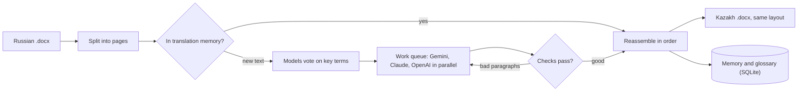

# tezau

**Translate 75+ page Word documents from Russian to Kazakh in minutes, for under $1, with terminology that stays consistent.**

[](https://github.com/YOUR_NAME/tezau/actions/workflows/tests.yml)


*Tez audar* means "translate fast" in Kazakh. tezau splits a long `.docx` into pages, translates them in parallel with
one or more LLMs (Gemini, Claude, OpenAI), checks every answer, and writes the result back into the same Word layout:
headings, tables, headers and footers stay where they were. A local database remembers every translation and every
agreed term, so the next document is cheaper and more consistent than the last.

<!-- demo: replace with docs/demo.gif -->

## Results on a real 75-page document

Measured on one 75-page Russian technical specification (2,280 paragraphs), October–November 2026.

| | Result |
|---|---|
| Cost of the full document | **$0.11** (58 pages; three models in parallel) |
| Time | **143 s** for the same run |
| Speed and tokens vs. the first naive run | **12× faster**, **8× fewer output tokens** per page (reasoning tuned down) |
| Term consistency with the shared glossary | **82.1% → 95.0%** (same 10 pages, glossary off vs. on) |
| Consistency over the whole document | **94.8%** of 4,211 term occurrences |
| Automatic checks after fixes | **0 errors** in 2,280 paragraphs (untranslated, half-translated, broken output, mixed alphabets) |
| AI judge (Claude Sonnet, 75 random paragraphs) | accuracy **4.35/5**, fluency **4.2/5**, MQM penalty 14.2 per 100 words |
| Human completeness review | **10 minutes** for the whole document, 0 issues left |

The AI judge's most common error type was terminology, which is where an expert's review still matters. tezau is
built to make that review short, not to replace it.

## What makes it different

- **Big files, page by page.** Pages of about 2,500 characters, each with the end of the previous page as context.
  Interrupted runs continue where they stopped.
- **Several models, one result.** Pages are shared out through a work queue; if a provider fails (quota, outage),
  the others take over its pages.
- **Models vote on terminology.** Before translating, the models propose translations for the key terms; the
  majority wins, disagreements are flagged for a human, and your own decisions always win.
- **Every answer is checked.** Rule-based checks catch Russian left in the text, half-translated sentences, glued
  JSON and Latin letters inside Kazakh words; only the bad paragraphs are translated again.
- **Translation memory.** A paragraph translated once is never paid for again, in this document or the next.
- **Works from Claude.** An MCP server lets Claude (Claude Code, Claude Desktop) estimate, translate, check and
  manage the glossary for you.

## How it works



The translation itself is a deterministic workflow, because it's cheaper and more predictable; the agentic loop
sits on top through MCP, where Claude orchestrates the tools.

## Quick start

```bash
git clone https://github.com/YOUR_NAME/tezau && cd tezau
python -m venv venv && source venv/bin/activate
pip install -e ".[all]"
cp .env.example .env        # add GEMINI_API_KEY (and optionally ANTHROPIC_API_KEY, OPENAI_API_KEY)
```

```bash
tezau estimate document.docx                                 # pages, tokens and cost, before spending anything
tezau translate document.docx document_kk.docx               # Gemini by default
tezau translate document.docx document_kk.docx --providers gemini,claude,openai --vote-terms
tezau eval check document.docx document_kk.docx              # quality report
tezau terms set "заявки" "өтінімдер"                          # your decision; models never change it
tezau translate document.docx test.docx --providers fake     # free dry run, no keys
```

Gemini is the default: in our measurements it had the fewest problems and the best term consistency.

## Use it from Claude (MCP)

```bash
claude mcp add --env TEZAU_HOME=$HOME/tezau --scope user \
  tezau -- $HOME/tezau/venv/bin/tezau-mcp
```

Then ask Claude: *"How much would it cost to translate /home/me/rules.docx?"*, *"Translate it"*, *"Check it"*.
Setup for Claude Desktop on macOS and Windows/WSL: [docs/MCP.md](docs/MCP.md).

## Evaluation

| Command | Measures |
|---|---|
| `tezau eval check` | automatic checks on every paragraph, problems per model, optional AI judge with MQM scores |
| `tezau eval consistency` | how often each agreed term was actually used, per model |
| `tezau eval post-edit` | how much a human editor changed (HTER) and minutes per page; can save the edits to memory |

70 tests run on every push (Ubuntu and macOS, Python 3.10 and 3.13) with fake models: no keys, no cost.

## Limits

- Only `.docx`. Convert `.doc`, `.odt` or Google Docs to `.docx` first; PDF is not supported.
- A paragraph with mixed formatting (one bold word) takes the formatting of its first run.
- One glossary entry per term: a word with several meanings in one document may get the wrong one.
- Rule-based checks find text left in Russian, not wrong meanings. Meaning needs the AI judge and a human.

## Privacy

The text of your document is sent to the provider that translates it. Anthropic and OpenAI do not use API data
for training by default; the Gemini free tier may use it to improve Google's products, so use a paid key for
confidential documents. Keys stay in your `.env`, which is never committed.

## Roadmap

- Local models with Ollama (no data leaves your computer) and a comparison against the cloud models
- Public benchmark (FLORES+, KazParC): chrF++, BLEU, COMET with confidence intervals
- Fine-tuning a small local model on human-corrected translations
- Several meanings per glossary term; PDF input

## License

[MIT](LICENSE)
